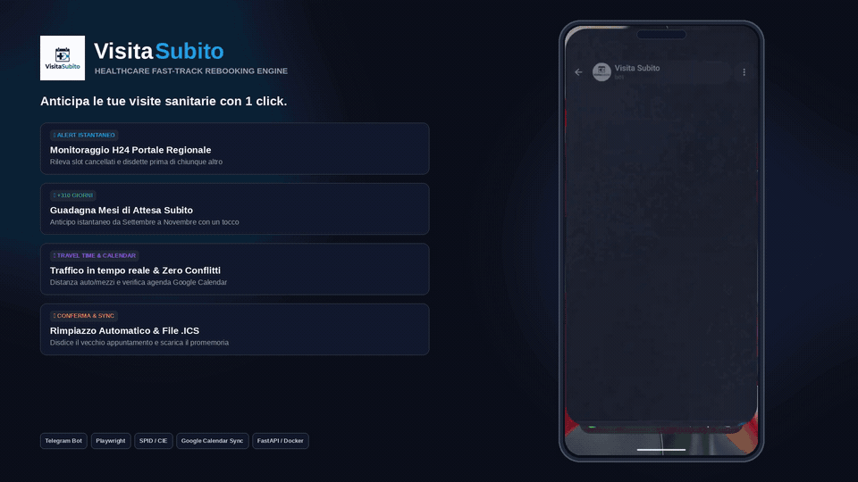
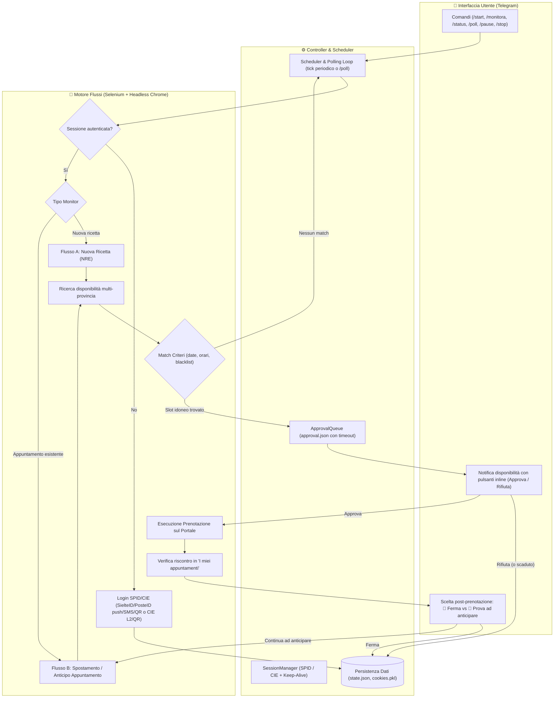

<p align="center">
  
</p>

<p align="center">
  <a href="docs/assets/visitasubito_showcase_1080p.mp4">
    
  </a>
</p>

<p align="center">
  <b>Monitoraggio e Anticipo Appuntamenti Fascicolo Sanitario (Regione Lombardia)</b><br>
  <i>Fa la guardia 24/7 alle disdette sul portale regionale e anticipa le tue visite mediche di mesi con un semplice tap.</i>
</p>

<p align="center">
  <a href="https://www.python.org/"></a>
  <a href="https://docs.pytest.org/"></a>
  <a href="https://www.docker.com/"></a>
  <a href="https://telegram.org/"></a>
  <a href="https://www.fascicolosanitario.regione.lombardia.it"></a>
  <a href="LICENSE"></a>
</p>

> 💡 **Ti hanno fissato una visita o un esame tra 12 o 18 mesi?**  
> Sul portale sanitario regionale i posti si liberano continuamente per disdette o nuove aperture di agende, ma spariscono nel giro di pochissimi minuti. Passare le giornate ad aggiornare manualmente la pagina sperando in una disdetta è estenuante e inefficiente.
>
> Questo bot **fa la guardia 24/7 al posto tuo**: monitora ininterrottamente le disponibilità sul portale regionale, intercetta le cancellazioni all'istante e ti invia una notifica interattiva su **Telegram** (o con avviso sonoro via console). Con un semplice tap su **"Approva"**, il bot blocca e prenota subito il nuovo appuntamento, anticipando la tua visita medica di settimane o addirittura mesi.

> [!IMPORTANT]
> **Compatibilità e limitazioni attuali**:
> - **Portale regionale**: al momento questo progetto supporta **esclusivamente il portale del Fascicolo Sanitario di Regione Lombardia** (`https://www.fascicolosanitario.regione.lombardia.it`).
> - **Autenticazione**: sono supportati l'accesso tramite **SPID** (testato e ottimizzato per **SielteID**; in **fase sperimentale per PosteID / Poste Italiane** con notifica push, SMS OTP o scansione QR Code inviato su Telegram) e l'accesso tramite **CIE (Carta d'Identità Elettronica)** (Livello 2 con credenziali/app CieID o scansione diretta del QR Code inviato su Telegram). Gli altri provider SPID sono supportati a livello standard con credenziali e secondo fattore.

---

## 🌟 Funzionalità principali

- **Monitoraggio nuove prenotazioni (Flow A)**: ricerca disponibilità a partire da ricette dematerializzate (NRE) prescritte e non ancora prenotate.
- **Anticipo / spostamento appuntamenti (Flow B)**: monitora visite già fissate per trovare date precedenti (anticipo) o più comode all'interno di un intervallo temporale desiderato.
- **Protezione automatica Malus Ticket (3 giorni lavorativi)**: arresto preventivo automatico dei monitor di anticipo quando mancano meno di 3 giorni lavorativi alla visita già fissata (escludendo sabati, domeniche e festività nazionali italiane), evitando l'addebito delle penali regionali per mancata o tardiva disdetta.
- **Fast-Track Auto-Booking ("Sniper mode" istantaneo)**: opzione disattivata di default che prenota all'istante le disponibilità ad altissima richiesta senza attendere il tap su Telegram, con vincolo di sicurezza configurabile (default $\ge 5$ giorni da `.env`) per tutelarsi da appuntamenti scomodi che non si potrebbero più disdire senza penale.
- **Riepilogo comparativo con vecchio appuntamento**: all'individuazione di un posto utile, il bot mostra chiaramente la nuova data a confronto con l'appuntamento originario e i giorni esatti di anticipo guadagnati.
- **Generazione Calendario (.ics) con cancellazione automatica**: esportazione automatica di file calendario RFC 5545 per ogni prenotazione o anticipo confermato. In caso di spostamento, il file include la revoca del vecchio appuntamento (`STATUS:CANCELLED`, `SEQUENCE:1`) consentendo ai calendari (Apple Calendar, Outlook, Google Calendar) di aggiornare o rimuovere automaticamente l'evento precedente.
- **Calcolo Distanza e Tempi di Percorso da Casa (Auto e Trasporto Pubblico)**: stima immediata della distanza chilometrica e dei tempi di percorrenza dalla tua abitazione all'ospedale o ambulatorio sia in auto (nelle ore di punta) sia con il trasporto pubblico (metro, treno suburbano/FS, navette e percorsi pedonali). Se non imposti le coordinate di casa in `.env`, la funzionalità rimane disattivata senza mostrare righe vuote. Architettura già predisposta per futuri filtri di distanza massima.
- **Wizard interattivo su Telegram**: creazione guidata dei monitor direttamente dalla chat con selezione di ricetta/appuntamento, scelta multi-provincia e calendario inline per l'intervallo date.
- **Gestione sessione SPID / CIE**: keep-alive automatico della sessione e rinnovo intelligente tramite SielteID, PosteID o CIE (Livello 2 / QR Code) con supporto interattivo su Telegram.
- **Strategie di ricerca multi-provincia**: modalità `first_match` (consigliata/rapida, blocca la prima data utile senza cambiare provincia riducendo le race condition sul portale) oppure `best_match` (globale, confronta tutte le province alla ricerca della data migliore).
- **Diagnostica automatica e screenshot Telegram**: salvataggio automatico di screenshot PNG e dump HTML in caso di errore o timeout durante la prenotazione, con invio immediato dell'immagine direttamente nella chat Telegram.
- **Benvenuto all'avvio e Controllo Aggiornamenti GitHub**: all'avvio dell'applicazione (tramite log, terminale CLI o messaggio di benvenuto Telegram) viene mostrato un banner riepilogativo con il link al repository GitHub, la versione corrente e la verifica immediata di nuove release pubblicate con pulsante per il download diretto o consultazione delle note di rilascio.
- **Completamente Dockerizzato**: pronto per l'esecuzione 24/7 in background con server X virtuale (`Xvfb`) e volumi persistenti per cookie e stato.

---

## 🏗️ Architettura e Flusso Operativo

Il sistema è composto da un bot Telegram asincrono (interfaccia utente), un orchestratore centrale (scheduler e session manager) e un motore di automazione browser basato su Selenium WebDriver con Google Chrome in ambiente virtuale (Xvfb).



---

## 💻 Versione Portatile Standalone (Windows & Linux - No Admin, No Docker)

Per gli utenti che non desiderano configurare ambienti virtuali Python o installare Docker, sono disponibili gli **eseguibili standalone precompilati** (rilasciati nelle **Releases** di GitHub/GitLab).

- **Nessuna installazione**: l'applicazione funziona come una *Portable App*.
- **Nessun privilegio di amministratore**: può essere avviata in qualsiasi cartella utente (Desktop, Documenti, cartella personale).
- **Setup guidato automatico (Wizard CLI)**: se il file `.env` non è presente, al primo avvio si apre automaticamente una procedura interattiva che guida passo-passo alla configurazione dei parametri Telegram e di autenticazione.

### 1. Download
Scarica l'archivio corrispondente al tuo sistema operativo dalla sezione **Releases**:
- **Windows**: `prenotazioni-windows-x86_64.zip`
- **Linux**: `prenotazioni-linux-x86_64.tar.gz`

### 2. Esecuzione e Primo Avvio
Estrai l'archivio in una cartella a tuo piacimento e avvialo:

- **Su Windows**:
  Apri il prompt dei comandi o PowerShell nella cartella estratta ed esegui:
  ```cmd
  prenotazioni.exe
  ```
  *(oppure fai doppio clic sull'eseguibile `prenotazioni.exe`)*

- **Su Linux**:
  Apri un terminale nella cartella ed esegui:
  ```bash
  chmod +x prenotazioni
  ./prenotazioni
  ```

### 3. Wizard di Configurazione
Al primo avvio, l'assistente ti chiederà a schermo:
1. **Token Bot Telegram** e **Chat ID** (per ricevere notifiche e gestire le visite).
2. **Metodo di Autenticazione** (SPID SielteID, altro fornitore SPID, CIE con credenziali app CieID o scansione QR Code su Telegram, oppure browser manuale).
3. **Strategia e intervallo di ricerca** (minuti di polling tra i controlli).

Al termine:
- Verrà generato automaticamente il file `.env` locale.
- Verrà predisposta la cartella locale `config/` con `monitors.yaml` e `settings.yaml` pronti da personalizzare.
- Lo stato, i log e i cookie di sessione verranno salvati nella sottocartella `data/` accanto all'eseguibile.
- Se desideri rilanciare il wizard in qualsiasi momento per aggiornare i parametri, avvia l'eseguibile con l'argomento `--wizard` (o `-w`):
  ```bash
  prenotazioni.exe --wizard
  ```

---

## 🚀 Avvio alternativo con Docker (Consigliato per Server / VPS)

Il modo più semplice e affidabile per eseguire il monitor è tramite **Docker Compose**.

### 1. Prerequisiti
- **Docker** e **Docker Compose** installati (su Linux, Windows con WSL2 o macOS).
- Credenziali **SPID** (provider SielteID con notifica push) oppure **CIE (Carta d'Identità Elettronica)** con app CieID per approvazione push, OTP o scansione QR Code su Telegram.

### 2. Configurazione del Bot Telegram
Prima di avviare l'applicazione, è necessario creare il proprio bot Telegram personale:

1. **Creare il bot con BotFather**:
   - Apri Telegram e cerca [@BotFather](https://t.me/BotFather) (l'account ufficiale con la spunta blu).
   - Invia il comando `/newbot`.
   - Inserisci un nome a piacere per il tuo bot (es. `Mio Monitor Sanitario`).
   - Scegli un *username* univoco che termini con `bot` (es. `miomonitor_sanitario_bot`).
   - BotFather ti risponderà fornendoti l'**API Token** (una stringa del tipo `123456789:ABCdefGHIjklMNOpqrSTUvwxYZ`). Questo valore corrisponde a `TG_TOKEN`.

2. **Recuperare il proprio Chat ID**:
   - Cerca su Telegram il bot [@userinfobot](https://t.me/userinfobot) (oppure [@raw_data_bot](https://t.me/raw_data_bot)).
   - Premi `/start`: il bot risponderà mostrandoti il tuo `Id` numerico personale (es. `123456789`). Questo valore corrisponde a `TG_CHAT_ID`.
   - *(Opzionale)* Se vuoi ricevere le notifiche anche su un gruppo Telegram, aggiungi il bot al gruppo e inserisci l'ID del gruppo (che comincia solitamente con un segno meno, es. `-987654321`) in `TG_CHAT_ID_SECONDARY`.

3. **Inizializzare la chat con il bot**:
   - **Passo fondamentale**: Apri la chat con il tuo bot appena creato e clicca su **AVVIA** (`/start`). Telegram impedisce ai bot di inviare messaggi agli utenti che non hanno preventivamente avviato la conversazione.

### 3. Configurazione `.env`
Copia il file di esempio ed inserisci le tue credenziali:

```bash
cp .env.example .env
```

Compila i campi nel file `.env`:
```env
# Telegram
TG_TOKEN=123456789:ABCdefGHIjklMNOpqrSTUvwxYZ
TG_CHAT_ID=123456789
TG_CHAT_ID_SECONDARY=

# Metodo di autenticazione: spid oppure cie
AUTH_METHOD=spid

# --- Se AUTH_METHOD=spid ---
# SPID SielteID
SPID_PROVIDER=sielte
SPID_USERNAME=il_tuo_username
SPID_PASSWORD=la_tua_password
SPID_OTP_MODE=notifica

# Oppure SPID PosteID (Poste Italiane) [SPERIMENTALE]
# SPID_PROVIDER=poste
# POSTE_USERNAME=il_tuo_username
# POSTE_PASSWORD=la_tua_password
# POSTE_MODE=app          # "app" (notifica push), "sms" (SMS OTP) o "qr" (QR Code)

# --- Se AUTH_METHOD=cie (Carta d'Identità Elettronica) ---
# CIE_MODE=app            # app (credenziali + push con fallback QR su Telegram) oppure qr (QR diretto)
# CIE_USERNAME=codice_fiscale_o_numero_cie
# CIE_PASSWORD=la_tua_password

# Scheduler & timeouts
POLL_INTERVAL_SECONDS=300
MAX_LOGIN_RETRIES=3
APPROVAL_TIMEOUT_SECONDS=600

# Strategia ricerca multi-provincia: first_match (consigliata/rapida) o best_match (globale)
SEARCH_STRATEGY=first_match

# Prevenzione penali malus ticket (giorni lavorativi minimi di preavviso per riprogrammare; default 3, 0 per disabilitare)
RESCHEDULE_MIN_WORKING_DAYS=3

# Fast-Track Auto-Booking: prenota subito senza attendere approvazione manuale (default: false)
AUTO_BOOK=false
# Giorni minimi di anticipo richiesti per auto-booking (tutela da appuntamenti scomodi non disdicibili; default: 5)
AUTO_BOOK_MIN_DAYS=5
DEBUG_DUMP_DIR=data/debug

# Controllo aggiornamenti GitHub e notifica di benvenuto all'avvio
CHECK_UPDATES=true
TG_STARTUP_NOTIFICATION=true
```

### 4. Avvio del container
Avvia il container in background:

```bash
docker compose up -d
```

### 5. Primo Accesso SPID / CIE
Alla prima esecuzione:
1. Il container si avvia e naviga automaticamente verso il portale di autenticazione.
2. In base alla modalità scelta in `AUTH_METHOD`:
   - **SPID (SielteID)**: riceverai un messaggio su Telegram (`📲 Sto per inviare la notifica SielteID...`). Apri l'app **SielteID** sul tuo smartphone e approva la richiesta push entro 3 minuti.
   - **SPID (PosteID - Sperimentale)**: supporta l'approvazione push su app **PosteID**, l'inserimento interattivo del codice **SMS OTP**, oppure la ricezione istantanea del **QR Code** su Telegram da inquadrare con la fotocamera dell'app PosteID.
   - **CIE**: il bot supporta l'accesso Livello 2 (credenziali + notifica su app CieID con fallback interattivo su Telegram che recapita il **QR Code** direttamente in chat da inquadrare con l'app CieID, oppure modalità diretta `CIE_MODE=qr`).
3. I cookie di sessione verranno salvati automaticamente nel volume persistente `./data/cookies/cookies.pkl`. Da questo momento in poi il monitor rimarrà attivo autonomamente.

### 6. Gestione del container
- **Visualizzare i log in tempo reale**:
  ```bash
  docker compose logs -f
  ```
- **Verificare lo stato del container**:
  ```bash
  docker compose ps
  ```
- **Fermare il container**:
  ```bash
  docker compose down
  ```
- **Riavviare il container**:
  ```bash
  docker compose restart
  ```

### 7. Deploy con Portainer
Se utilizzi **Portainer** per gestire i tuoi container Docker, è disponibile una configurazione ottimizzata che evita problemi con i file `.env` locali e sfrutta i volumi gestiti di Docker:
- **File Compose dedicato**: [`docker-compose.portainer.yml`](docker-compose.portainer.yml) (non necessita di `.env` su disco, legge le variabili inserite direttamente nell'interfaccia di Portainer).
- **Guida passo-passo**: consulta 🚢 **[Guida al Deploy con Portainer](docs/PORTAINER.md)** per le istruzioni dettagliate sia con repository Git (consigliato con auto-aggiornamento) che con Web Editor.

---

## 🛡️ Prevenzione Penali e "Malus Ticket" (3 Giorni Lavorativi)

In Italia e nello specifico in **Regione Lombardia** (D.G.R. n. IX/3379 e regolamenti di gestione delle liste d'attesa delle ASST/ATS), il cittadino che non può presentarsi a un appuntamento già prenotato **ha l'obbligo di disdire o spostare la prenotazione con almeno 3 giorni lavorativi di anticipo**. 

> [!WARNING]
> **Che cos'è il Malus Ticket?**  
> In caso di mancata disdetta o disdetta tardiva (con meno di 3 giorni lavorativi di preavviso), la legge regionale prevede l'addebito del cosiddetto **"Malus Ticket"**, ovvero l'obbligo di pagare l'**intera tariffa della prestazione** non fruita (fino al massimale previsto per singola ricetta), **anche per i cittadini in possesso di esenzione ticket** per reddito o patologia.

Per tutelare l'utente da addebiti economici sanzionatori dovuti a spostamenti dell'ultimo momento, il bot integra una **protezione preventiva intelligente**:

### 1. Calcolo rigoroso dei giorni lavorativi
- **Esclusione dei fine settimana**: sabati e domeniche non vengono mai conteggiati come giorni lavorativi.
- **Festività nazionali italiane**: il sistema esclude automaticamente tutte le festività civili e religiose nazionali (Capodanno, Epifania, 25 Aprile, 1° Maggio, 2 Giugno, Ferragosto, Tutti i Santi, Immacolata, Natale, Santo Stefano) e il **Lunedì dell'Angelo (Pasquetta)**, calcolato dinamicamente tramite algoritmo astronomico per qualsiasi anno solare.

### 2. Arresto preventivo automatico del monitor
- Durante il ciclo di polling (`poll_once`), se mancano **meno di 3 giorni lavorativi** alla data della visita già prenotata (`data_attuale`), il monitor viene **arrestato immediatamente** e contrassegnato come `stopped_deadline`.
- **Notifica e allarme sonoro**: il bot invia una notifica immediata (su Telegram o terminale) informando che il monitoraggio è stato fermato a scopo preventivo per evitare il rischio di penale, riproducendo contemporaneamente un segnale acustico di avviso (`alert`).
- **Blocco in fase di creazione**: se tenti di avviare un monitor di anticipo (`/anticipa` o `/monitora`) per una visita la cui deadline di 3 giorni lavorativi è già superata, il bot rifiuterà la creazione spiegando chiaramente il motivo.

### 3. Confronto trasparente delle date
Quando viene individuata una data utile prima della deadline di sicurezza:
- La notifica di approvazione riporta in modo esplicito sia la **Nuova data proposta** sia l'**Appuntamento attuale da sostituire**, indicando i giorni esatti di anticipo guadagnati:
  ```text
  Nuova data proposta: 22/05/2027 09:30
  📌 Appuntamento attuale da sostituire: 24/09/2027 10:30 (124 giorni di anticipo)
  ```
- Anche il messaggio finale di conferma prenotazione specifica la sostituzione della visita precedente.

### 4. Configurazione della soglia
La soglia di default è di **3 giorni lavorativi**, ma può essere modificata o disabilitata tramite la variabile d'ambiente `RESCHEDULE_MIN_WORKING_DAYS` nel file `.env` (o in `config/settings.yaml` alla voce `reschedule_min_working_days`):

```env
# Default: 3 giorni lavorativi. Imposta a 0 per disabilitare il blocco preventivo.
RESCHEDULE_MIN_WORKING_DAYS=3
```

---

## ⚡ Fast-Track Auto-Booking ("Sniper Mode")

Sulle prestazioni sanitarie ad altissima richiesta (es. risonanze magnetiche, ecografie o prime visite specialistiche a Milano), i posti resi disponibili da cancellazioni altrui spariscono spesso nel giro di **30-90 secondi**. Il flusso tradizionale con richiesta interattiva su Telegram (notifica $\to$ lettura dello smartphone $\to$ tap su "Approva") può risultare troppo lento per bloccare lo slot in tempo (*race condition* con altri utenti o sportelli CUP).

Per massimizzare le probabilità di successo, il bot include la modalità **Fast-Track Auto-Booking**:

### 1. Disattivata di default per massima sicurezza
La funzionalità è disattivata di default (`AUTO_BOOK=false`): per impostazione predefinita il bot richiede **sempre** la tua approvazione manuale. Nessun appuntamento verrà mai prenotato in automatico a tua insaputa a meno che tu non scelga espressamente di abilitarla.

### 2. Soglia di tutela preventiva (`AUTO_BOOK_MIN_DAYS`)
Quando la modalità è attiva, entra in gioco un vincolo di sicurezza fondamentale:

> [!IMPORTANT]
> **A cosa serve il margine di anticipo minimo (default: 5 giorni)?**  
> Questo numero serve a tutelarsi da possibili appuntamenti scomodi che, se prenotati con scarso preavviso (es. per il giorno successivo o due giorni dopo), **non potrebbero più essere spostati in avanti o disdetti senza pagare la sanzione economica** (regola dei 3 giorni lavorativi di preavviso per evitare il *malus ticket*).

- **Slot con preavviso $\ge 5$ giorni**: il bot procede all'istante con la prenotazione senza attendere la risposta su Telegram, riproduce un segnale acustico prioritario e ti notifica subito la conferma con il riepilogo della visita e della vecchia data sostituita. Avrai giorni a sufficienza per consultare la tua agenda e, se l'orario o la sede non fossero comodi, disdire o spostare la visita in tutta serenità prima che scatti il termine di 3 giorni lavorativi.
- **Slot con preavviso $< 5$ giorni (Fallback trasparente)**: se viene trovato un posto valido ma troppo vicino nel tempo (a meno di 5 giorni da oggi), il bot **non lo prenota in automatico per prudenza**, ma invia la consueta richiesta con bottoni interattivi (`Approva` / `Rifiuta`), spiegando che l'auto-booking è stato escluso per evitare il rischio di penale. Se sei disponibile puoi comunque approvarlo manualmente in un tap.

### 3. Configurazione
Puoi abilitare l'auto-booking e personalizzare il margine di giorni nel file `.env`:

```env
# Abilita la prenotazione istantanea automatica (default: false)
AUTO_BOOK=true

# Giorni minimi di anticipo rispetto ad oggi per autorizzare l'auto-booking (default: 5)
AUTO_BOOK_MIN_DAYS=5
```

È inoltre possibile abilitare o disabilitare l'auto-booking a livello di singolo monitor impostando `auto_book: true` all'interno della sezione `criteri` in `config/monitors.yaml`.

---

## 🧭 Calcolo Distanza & Tempi di Percorso da Casa (Auto e Trasporto Pubblico)

Quando il bot trova una disponibilità o invia una notifica di approvazione/prenotazione, può mostrare la **distanza stradale effettiva** e i **tempi stimati di viaggio** rispetto a casa tua, sia in **automobile** che con il **trasporto pubblico** (metropolitana, passante/treno, autobus o a piedi).

### 📍 Come funziona
1. **Origine (Coordinate di casa)**: impostate nel file `.env` tramite la variabile `HOME_COORDINATES` (es. `45.4642, 9.1900`).
2. **Destinazione (Struttura sanitaria)**: geocodificata all'istante a partire dai dati della visita (`sede`, `azienda`, `comune`).
   - Il sistema include un database offline pre-mappato dei **principali ospedali, ASST, IRCCS e cliniche della Lombardia** (Niguarda, San Raffaele, Policlinico, San Paolo, San Carlo, Sacco, Fatebenefratelli, Buzzi, Gaetano Pini, San Donato, Humanitas, San Gerardo Monza, Papa Giovanni XXIII Bergamo, Spedali Civili Brescia, Sant'Anna Como, Circolo Varese, Manzoni Lecco, San Matteo Pavia, Ospedale Maggiore di Lodi, Cremona, Mantova, Sondrio, ecc.). La risoluzione è immediata (0 ms di latenza).
   - In caso di strutture periferiche o poliambulatori non indicizzati, viene effettuata una ricerca tramite OpenStreetMap con memorizzazione permanente nella cache locale (`data/geocache.json`), senza rallentare le notifiche successive.
3. **Calcolo in Auto (Ore di punta)**:
   - Stima la distanza stradale effettiva applicando un fattore di tortuosità urbano/suburbano ($1.35 \times$ distanza in linea d'aria).
   - Calcola il tempo di guida a scaglioni realistici per simulare il traffico cittadino e dell'hinterland (velocità urbana media $\approx 19\text{--}28$ km/h per percorsi brevi, $\approx 40$ km/h per tratte fino a 25 km, e scorrimento tangenziale/autostradale per tragitti extraurbani superiori).
4. **Calcolo Trasporto Pubblico (Metro, Treno e Autobus)**:
   - Identifica la stazione metropolitana o ferroviaria suburbana più vicina a casa tua e quella più comoda per la struttura di destinazione (copre la rete metropolitana di Milano M1, M2, M3, M4, M5, la metropolitana di Brescia e tutti i principali nodi ferroviari della Lombardia come Monza, Saronno, Bergamo, Brescia, Como, Pavia, Lecco, Varese, Lodi, Cremona, Mantova, Gallarate, Busto Arsizio, Rho, Treviglio, Pioltello).
   - Calcola il tempo di accesso a piedi (o con navetta/bus se $> 2\text{ km}$), la percorrenza sui binari/linea metropolitana, le coincidenze con penalità di cambio linea e l'ultimo tratto pedonale verso l'ospedale.
5. **Riconoscimento Distanze Brevi (A piedi)**:
   - Se la struttura sanitaria dista $\le 850\text{ metri}$ in linea d'aria dalla tua abitazione, il messaggio evidenzia prioritariamente il tempo a piedi:  
     `🚶 8 min a piedi (600 m) · 🚗 5 min in auto`

---

### 📱 Esempio di notifica su Telegram

Se le coordinate sono configurate, nel messaggio di richiesta approvazione o auto-booking comparirà la riga dedicata subito sotto il link a Google Maps:

```text
🩺 Trovata disponibilità (new-VISITA-OCULISTICA-1)
📅 Data: 12/11/2026 ore 10:30 · MI
🏥 ASST GRANDE OSPEDALE METROPOLITANO NIGUARDA
📍 OSPEDALE NIGUARDA CA' GRANDA · MILANO
🗺 Apri in Google Maps
🧭 Distanza da casa: 🚗 22 min in auto (14.2 km) · 🚇 35 min con trasporto pubblico (M2 + M1)

Vuoi procedere?
[✅ Approva] [❌ Rifiuta]
```

---

### ⚙️ Come configurare le tue coordinate in `.env`

> [!IMPORTANT]  
> **Se non imposti le coordinate di casa, la funzionalità è completamente disattivata.**  
> Il bot non calcola distanze, non invia richieste a servizi di geolocalizzazione e non mostra alcuna riga vuota o dicitura anomala nei messaggi.

#### Come trovare le coordinate di casa tua in 10 secondi:
1. Apri [Google Maps](https://www.google.com/maps) dal tuo browser web o dallo smartphone.
2. Cerca la tua abitazione o fai **clic con il tasto destro del mouse** esattamente sul punto della tua casa.
3. Nella finestrella che si apre, la prima riga in alto mostra due numeri separati da virgola (es. `45.4642, 9.1900`). Cliccaci sopra con il mouse: le coordinate verranno **copiate automaticamente negli appunti**.
4. Incolla il valore nel file `.env`:

```env
# Coordinate della tua abitazione (latitudine, longitudine)
HOME_COORDINATES=45.4642, 9.1900
```

*(In alternativa sono supportate anche le due variabili separate `HOME_LATITUDE=45.4642` e `HOME_LONGITUDE=9.1900`, oppure l'impostazione per singolo monitor o globale in `config/settings.yaml`).*

---

### 🔮 Predisposizione per Filtri Futuri sulla Distanza

L'architettura del modulo `services/commute.py` e del `services/matcher.py` è **già predisposta** per supportare filtri avanzati sui criteri di ricerca (attualmente non attivi di default). In futuro o per monitor specializzati sarà sufficiente specificare nei `criteri` del monitor:

```yaml
# Esempio di filtri futuri supportati dall'architettura:
criteri:
  max_distance_km: 20       # Scarta visite oltre 20 km di strada da casa
  max_car_minutes: 30       # Scarta visite che richiedono più di 30 min in auto
  max_transit_minutes: 45   # Scarta visite che richiedono più di 45 min con il trasporto pubblico
```

---

## 🤖 Comandi Telegram

Una volta avviato, tutte le operazioni si gestiscono comodamente dalla chat con il bot:

| Comando | Descrizione |
| :--- | :--- |
| `/start` | Messaggio di benvenuto e scorciatoie principali. |
| `/monitora` | **Wizard guidato**: seleziona se monitorare una nuova ricetta o un appuntamento esistente, scegli le province di ricerca e imposta l'intervallo temporale tramite calendario interattivo. |
| `/anticipa` | **Scorciatoia rapida anticipo**: seleziona un appuntamento esistente per cercare una data precedente, con verifica preventiva immediata della deadline anti-penale. |
| `/stop` | Mostra i monitor attivi e permette di interromperne uno con un click. |
| `/status` | Visualizza lo stato di tutti i monitor attivi (inclusa la deadline di sicurezza per le riprogrammazioni), lo stato della sessione SPID/CIE e il tempo rimanente al prossimo controllo. |
| `/poll` | Forza un giro di verifica immediato delle disponibilità senza attendere l'intervallo schedulato. |
| `/ricette` | Mostra le ricette dematerializzate più recenti presenti sul fascicolo (con stato e pulsante per scaricare il PDF promemoria). |
| `/appuntamenti` | Mostra l'elenco degli appuntamenti già prenotati con data, struttura sanitaria, indirizzo e link rapido a Google Maps. |
| `/version` | Mostra la versione attualmente installata e controlla se ci sono nuove release su GitHub. |
| `/help` | Elenco di riepilogo di tutti i comandi disponibili. |

---

## 💻 Esecuzione in locale (Senza Docker)

Se preferisci eseguire l'applicazione direttamente sul sistema operativo:

### 1. Creazione ambiente virtuale
```bash
python3 -m venv .venv
source .venv/bin/activate  # Su Linux/macOS
# oppure su Windows: .venv\Scripts\activate
pip install -r requirements.txt
```

### 2. Configurazione binario Chrome
Assicurati di avere Google Chrome installato. Puoi specificare il percorso del binario in `.env` o in `config/settings.yaml` (lasciandolo vuoto, Selenium Manager rileverà automaticamente il browser di sistema).

### 3. Avvio
```bash
python main.py
```
*(Opzionale: aggiungi il flag `--nobot` se desideri eseguire solo il poller di background senza avviare il listener Telegram nello stesso processo).*

---

## 🧪 Esecuzione dei Test

Il progetto include una suite completa di unit test (eseguibili senza browser e senza connessione a internet) con `pytest`:

```bash
pip install -r requirements-dev.txt
pytest
```

---

## 📂 Struttura del Progetto

```text
├── config/
│   ├── settings.yaml     # Parametri globali (browser, scheduler, logging, telegram)
│   └── monitors.yaml     # Monitor statici iniziali (opzionali)
├── core/
│   ├── browser.py        # Wrapper Selenium Chrome (gestione headless/display)
│   ├── config.py         # Caricamento e merge configurazioni YAML + env
│   ├── selectors.py      # Mappatura selettori CSS/XPath del portale regionale
│   └── session.py        # Gestione sessione SPID/CIE, salvataggio cookie, login Sielte/CIE
├── flows/
│   ├── base.py           # Classe base per i flussi di ricerca
│   ├── new_booking.py    # Flusso A: prenotazione nuova ricetta
│   └── reschedule.py     # Flusso B: anticipo/spostamento appuntamento
├── services/
│   ├── approval.py       # Gestione coda richieste di conferma (approval.json)
│   ├── matcher.py        # Algoritmo di matching disponibilità secondo i criteri
│   ├── ricette.py        # Parser e classificazione ricette (specialistica/laboratorio)
│   ├── scheduler.py      # Orchestratore keep-alive e ciclo di polling
│   └── telegram_bot.py   # Bot Telegram asincrono e wizard interattivi
├── state/
│   └── store.py          # Persistenza stato monitor e prenotazioni (state.json)
├── tests/                # Suite di test unitari con pytest
├── data/                 # Directory persistente (cookie, state.json, log)
├── docs/
│   └── PORTAINER.md      # Guida dettagliata al deploy tramite Portainer
├── entrypoint.sh         # Script di avvio container con server X virtuale (Xvfb)
├── Dockerfile            # Immagine Docker Python 3.11 con Google Chrome
├── docker-compose.yml    # Definizione standard del servizio containerizzato
└── docker-compose.portainer.yml # Stack ottimizzato per Portainer (variabili da UI)
```

---

## ⭐ Star History

<p align="center">
  <a href="https://star-history.com/#metagliatore/visita-subito&Date">
    <picture>
      <source media="(prefers-color-scheme: dark)" srcset="https://api.star-history.com/svg?repos=metagliatore/visita-subito&type=Date&theme=dark" />
      <source media="(prefers-color-scheme: light)" srcset="https://api.star-history.com/svg?repos=metagliatore/visita-subito&type=Date" />
      
    </picture>
  </a>
</p>

---

## ⚠️ Disclaimer

Questo software è un progetto personale realizzato a scopo di studio e automazione privata. Non è in alcun modo affiliato, sponsorizzato o approvato da Regione Lombardia, ARIA S.p.A. o AgID. L'utilizzo del software è sotto la responsabilità esclusiva dell'utente, nel rispetto dei termini di servizio del portale e delle normative vigenti.
