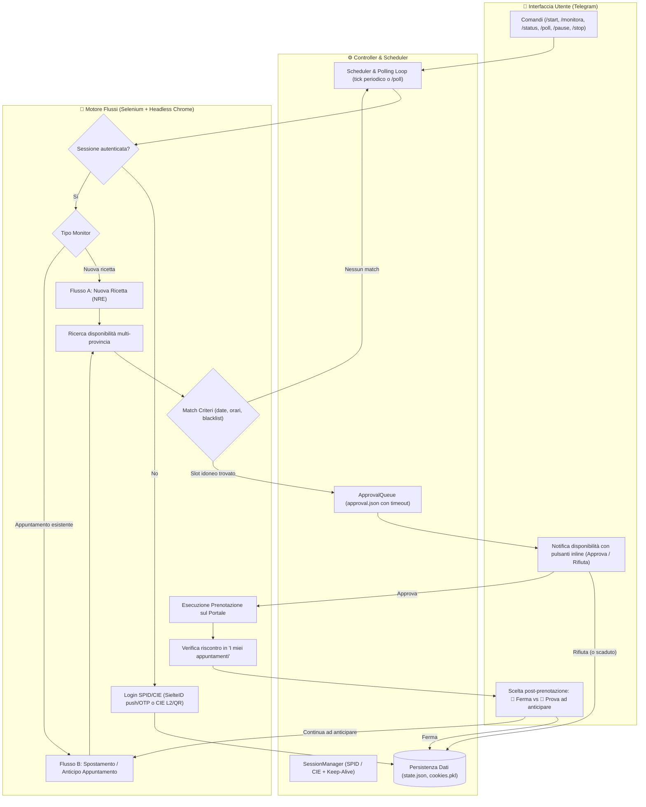

# 🏥 Monitor Appuntamenti Fascicolo Sanitario (Regione Lombardia)

Bot automatizzato che controlla periodicamente le disponibilità per visite ed esami medici specialistici sul portale del Fascicolo Sanitario Elettronico e invia notifiche interattive via **Telegram** per approvare o rifiutare le date trovate.

> [!IMPORTANT]
> **Compatibilità e limitazioni attuali**:
> - **Portale regionale**: al momento questo progetto supporta **esclusivamente il portale del Fascicolo Sanitario di Regione Lombardia** (`https://www.fascicolosanitario.regione.lombardia.it`).
> - **Autenticazione**: sono supportati l'accesso tramite **SPID** (attualmente testato con SielteID via notifica push o OTP) e l'accesso tramite **CIE (Carta d'Identità Elettronica)** (Livello 2 con credenziali/app CieID o scansione diretta del QR Code inviato su Telegram). Gli altri provider SPID non sono al momento implementati nel flusso di login automatico.

---

## 🌟 Funzionalità principali

- **Monitoraggio nuove prenotazioni (Flow A)**: ricerca disponibilità a partire da ricette dematerializzate (NRE) prescritte e non ancora prenotate.
- **Anticipo / spostamento appuntamenti (Flow B)**: monitora visite già fissate per trovare date precedenti (anticipo) o più comode all'interno di un intervallo temporale desiderato.
- **Wizard interattivo su Telegram**: creazione guidata dei monitor direttamente dalla chat con selezione di ricetta/appuntamento, scelta multi-provincia e calendario inline per l'intervallo date.
- **Gestione sessione SPID / CIE**: keep-alive automatico della sessione e rinnovo intelligente tramite SielteID o CIE (Livello 2 / QR Code) con supporto interattivo su Telegram.
- **Strategie di ricerca multi-provincia**: modalità `first_match` (consigliata/rapida, blocca la prima data utile senza cambiare provincia riducendo le race condition sul portale) oppure `best_match` (globale, confronta tutte le province alla ricerca della data migliore).
- **Diagnostica automatica e screenshot Telegram**: salvataggio automatico di screenshot PNG e dump HTML in caso di errore o timeout durante la prenotazione, con invio immediato dell'immagine direttamente nella chat Telegram.
- **Completamente Dockerizzato**: pronto per l'esecuzione 24/7 in background con server X virtuale (`Xvfb`) e volumi persistenti per cookie e stato.

---

## 🏗️ Architettura e Flusso Operativo

Il sistema è composto da un bot Telegram asincrono (interfaccia utente), un orchestratore centrale (scheduler e session manager) e un motore di automazione browser basato su Selenium WebDriver con Google Chrome in ambiente virtuale (Xvfb).



---

## 💻 Versione Portatile Standalone (Windows & Linux - No Admin, No Docker)

Per gli utenti che non desiderano configurare ambienti virtuali Python o installare Docker, sono disponibili gli **eseguibili standalone precompilati** (rilasciati nelle **Releases** di GitHub/GitLab).

- **Nessuna installazione**: l'applicazione funziona come una *Portable App*.
- **Nessun privilegio di amministratore**: può essere avviata in qualsiasi cartella utente (Desktop, Documenti, cartella personale).
- **Setup guidato automatico (Wizard CLI)**: se il file `.env` non è presente, al primo avvio si apre automaticamente una procedura interattiva che guida passo-passo alla configurazione dei parametri Telegram e di autenticazione.

### 1. Download
Scarica l'archivio corrispondente al tuo sistema operativo dalla sezione **Releases**:
- **Windows**: `prenotazioni-windows-x86_64.zip`
- **Linux**: `prenotazioni-linux-x86_64.tar.gz`

### 2. Esecuzione e Primo Avvio
Estrai l'archivio in una cartella a tuo piacimento e avvialo:

- **Su Windows**:
  Apri il prompt dei comandi o PowerShell nella cartella estratta ed esegui:
  ```cmd
  prenotazioni.exe
  ```
  *(oppure fai doppio clic sull'eseguibile `prenotazioni.exe`)*

- **Su Linux**:
  Apri un terminale nella cartella ed esegui:
  ```bash
  chmod +x prenotazioni
  ./prenotazioni
  ```

### 3. Wizard di Configurazione
Al primo avvio, l'assistente ti chiederà a schermo:
1. **Token Bot Telegram** e **Chat ID** (per ricevere notifiche e gestire le visite).
2. **Metodo di Autenticazione** (SPID SielteID, altro fornitore SPID, CIE con credenziali app CieID o scansione QR Code su Telegram, oppure browser manuale).
3. **Strategia e intervallo di ricerca** (minuti di polling tra i controlli).

Al termine:
- Verrà generato automaticamente il file `.env` locale.
- Verrà predisposta la cartella locale `config/` con `monitors.yaml` e `settings.yaml` pronti da personalizzare.
- Lo stato, i log e i cookie di sessione verranno salvati nella sottocartella `data/` accanto all'eseguibile.
- Se desideri rilanciare il wizard in qualsiasi momento per aggiornare i parametri, avvia l'eseguibile con l'argomento `--wizard` (o `-w`):
  ```bash
  prenotazioni.exe --wizard
  ```

---

## 🚀 Avvio alternativo con Docker (Consigliato per Server / VPS)

Il modo più semplice e affidabile per eseguire il monitor è tramite **Docker Compose**.

### 1. Prerequisiti
- **Docker** e **Docker Compose** installati (su Linux, Windows con WSL2 o macOS).
- Credenziali **SPID** (provider SielteID con notifica push) oppure **CIE (Carta d'Identità Elettronica)** con app CieID per approvazione push, OTP o scansione QR Code su Telegram.

### 2. Configurazione del Bot Telegram
Prima di avviare l'applicazione, è necessario creare il proprio bot Telegram personale:

1. **Creare il bot con BotFather**:
   - Apri Telegram e cerca [@BotFather](https://t.me/BotFather) (l'account ufficiale con la spunta blu).
   - Invia il comando `/newbot`.
   - Inserisci un nome a piacere per il tuo bot (es. `Mio Monitor Sanitario`).
   - Scegli un *username* univoco che termini con `bot` (es. `miomonitor_sanitario_bot`).
   - BotFather ti risponderà fornendoti l'**API Token** (una stringa del tipo `123456789:ABCdefGHIjklMNOpqrSTUvwxYZ`). Questo valore corrisponde a `TG_TOKEN`.

2. **Recuperare il proprio Chat ID**:
   - Cerca su Telegram il bot [@userinfobot](https://t.me/userinfobot) (oppure [@raw_data_bot](https://t.me/raw_data_bot)).
   - Premi `/start`: il bot risponderà mostrandoti il tuo `Id` numerico personale (es. `123456789`). Questo valore corrisponde a `TG_CHAT_ID`.
   - *(Opzionale)* Se vuoi ricevere le notifiche anche su un gruppo Telegram, aggiungi il bot al gruppo e inserisci l'ID del gruppo (che comincia solitamente con un segno meno, es. `-987654321`) in `TG_CHAT_ID_SECONDARY`.

3. **Inizializzare la chat con il bot**:
   - **Passo fondamentale**: Apri la chat con il tuo bot appena creato e clicca su **AVVIA** (`/start`). Telegram impedisce ai bot di inviare messaggi agli utenti che non hanno preventivamente avviato la conversazione.

### 3. Configurazione `.env`
Copia il file di esempio ed inserisci le tue credenziali:

```bash
cp .env.example .env
```

Compila i campi nel file `.env`:
```env
# Telegram
TG_TOKEN=123456789:ABCdefGHIjklMNOpqrSTUvwxYZ
TG_CHAT_ID=123456789
TG_CHAT_ID_SECONDARY=

# Metodo di autenticazione: spid oppure cie
AUTH_METHOD=spid

# --- Se AUTH_METHOD=spid (SielteID) ---
SPID_PROVIDER=sielte
SPID_USERNAME=il_tuo_username
SPID_PASSWORD=la_tua_password
SPID_OTP_MODE=notifica

# --- Se AUTH_METHOD=cie (Carta d'Identità Elettronica) ---
# CIE_MODE=app            # app (credenziali + push con fallback QR su Telegram) oppure qr (QR diretto)
# CIE_USERNAME=codice_fiscale_o_numero_cie
# CIE_PASSWORD=la_tua_password

# Scheduler & timeouts
POLL_INTERVAL_SECONDS=300
MAX_LOGIN_RETRIES=3
APPROVAL_TIMEOUT_SECONDS=600

# Strategia ricerca multi-provincia: first_match (consigliata/rapida) o best_match (globale)
SEARCH_STRATEGY=first_match
DEBUG_DUMP_DIR=data/debug
```

### 4. Avvio del container
Avvia il container in background:

```bash
docker compose up -d
```

### 5. Primo Accesso SPID / CIE
Alla prima esecuzione:
1. Il container si avvia e naviga automaticamente verso il portale di autenticazione.
2. In base alla modalità scelta in `AUTH_METHOD`:
   - **SPID (SielteID)**: riceverai un messaggio su Telegram (`📲 Sto per inviare la notifica SielteID...`). Apri l'app **SielteID** sul tuo smartphone e approva la richiesta push entro 3 minuti.
   - **CIE**: il bot supporta l'accesso Livello 2 (credenziali + notifica su app CieID con fallback interattivo su Telegram che recapita il **QR Code** direttamente in chat da inquadrare con l'app CieID, oppure modalità diretta `CIE_MODE=qr`).
3. I cookie di sessione verranno salvati automaticamente nel volume persistente `./data/cookies/cookies.pkl`. Da questo momento in poi il monitor rimarrà attivo autonomamente.

### 6. Gestione del container
- **Visualizzare i log in tempo reale**:
  ```bash
  docker compose logs -f
  ```
- **Verificare lo stato del container**:
  ```bash
  docker compose ps
  ```
- **Fermare il container**:
  ```bash
  docker compose down
  ```
- **Riavviare il container**:
  ```bash
  docker compose restart
  ```

### 7. Deploy con Portainer
Se utilizzi **Portainer** per gestire i tuoi container Docker, è disponibile una configurazione ottimizzata che evita problemi con i file `.env` locali e sfrutta i volumi gestiti di Docker:
- **File Compose dedicato**: [`docker-compose.portainer.yml`](docker-compose.portainer.yml) (non necessita di `.env` su disco, legge le variabili inserite direttamente nell'interfaccia di Portainer).
- **Guida passo-passo**: consulta 🚢 **[Guida al Deploy con Portainer](docs/PORTAINER.md)** per le istruzioni dettagliate sia con repository Git (consigliato con auto-aggiornamento) che con Web Editor.

---

## 🤖 Comandi Telegram

Una volta avviato, tutte le operazioni si gestiscono comodamente dalla chat con il bot:

| Comando | Descrizione |
| :--- | :--- |
| `/start` | Messaggio di benvenuto e scorciatoie principali. |
| `/monitora` | **Wizard guidato**: seleziona se monitorare una nuova ricetta o un appuntamento esistente, scegli le province di ricerca e imposta l'intervallo temporale tramite calendario interattivo. |
| `/stop` | Mostra i monitor attivi e permette di interromperne uno con un click. |
| `/status` | Visualizza lo stato di tutti i monitor attivi, lo stato della sessione SPID/CIE e il tempo rimanente al prossimo controllo. |
| `/poll` | Forza un giro di verifica immediato delle disponibilità senza attendere l'intervallo schedulato. |
| `/ricette` | Mostra le ricette dematerializzate più recenti presenti sul fascicolo (con stato e pulsante per scaricare il PDF promemoria). |
| `/appuntamenti` | Mostra l'elenco degli appuntamenti già prenotati con data, struttura sanitaria, indirizzo e link rapido a Google Maps. |
| `/help` | Elenco di riepilogo di tutti i comandi disponibili. |

---

## 💻 Esecuzione in locale (Senza Docker)

Se preferisci eseguire l'applicazione direttamente sul sistema operativo:

### 1. Creazione ambiente virtuale
```bash
python3 -m venv .venv
source .venv/bin/activate  # Su Linux/macOS
# oppure su Windows: .venv\Scripts\activate
pip install -r requirements.txt
```

### 2. Configurazione binario Chrome
Assicurati di avere Google Chrome installato. Puoi specificare il percorso del binario in `.env` o in `config/settings.yaml` (lasciandolo vuoto, Selenium Manager rileverà automaticamente il browser di sistema).

### 3. Avvio
```bash
python main.py
```
*(Opzionale: aggiungi il flag `--nobot` se desideri eseguire solo il poller di background senza avviare il listener Telegram nello stesso processo).*

---

## 🧪 Esecuzione dei Test

Il progetto include una suite completa di unit test (eseguibili senza browser e senza connessione a internet) con `pytest`:

```bash
pip install -r requirements-dev.txt
pytest
```

---

## 📂 Struttura del Progetto

```text
├── config/
│   ├── settings.yaml     # Parametri globali (browser, scheduler, logging, telegram)
│   └── monitors.yaml     # Monitor statici iniziali (opzionali)
├── core/
│   ├── browser.py        # Wrapper Selenium Chrome (gestione headless/display)
│   ├── config.py         # Caricamento e merge configurazioni YAML + env
│   ├── selectors.py      # Mappatura selettori CSS/XPath del portale regionale
│   └── session.py        # Gestione sessione SPID/CIE, salvataggio cookie, login Sielte/CIE
├── flows/
│   ├── base.py           # Classe base per i flussi di ricerca
│   ├── new_booking.py    # Flusso A: prenotazione nuova ricetta
│   └── reschedule.py     # Flusso B: anticipo/spostamento appuntamento
├── services/
│   ├── approval.py       # Gestione coda richieste di conferma (approval.json)
│   ├── matcher.py        # Algoritmo di matching disponibilità secondo i criteri
│   ├── ricette.py        # Parser e classificazione ricette (specialistica/laboratorio)
│   ├── scheduler.py      # Orchestratore keep-alive e ciclo di polling
│   └── telegram_bot.py   # Bot Telegram asincrono e wizard interattivi
├── state/
│   └── store.py          # Persistenza stato monitor e prenotazioni (state.json)
├── tests/                # Suite di test unitari con pytest
├── data/                 # Directory persistente (cookie, state.json, log)
├── docs/
│   └── PORTAINER.md      # Guida dettagliata al deploy tramite Portainer
├── entrypoint.sh         # Script di avvio container con server X virtuale (Xvfb)
├── Dockerfile            # Immagine Docker Python 3.11 con Google Chrome
├── docker-compose.yml    # Definizione standard del servizio containerizzato
└── docker-compose.portainer.yml # Stack ottimizzato per Portainer (variabili da UI)
```

---

## ⚠️ Disclaimer

Questo software è un progetto personale realizzato a scopo di studio e automazione privata. Non è in alcun modo affiliato, sponsorizzato o approvato da Regione Lombardia, ARIA S.p.A. o AgID. L'utilizzo del software è sotto la responsabilità esclusiva dell'utente, nel rispetto dei termini di servizio del portale e delle normative vigenti.
